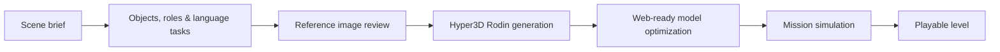
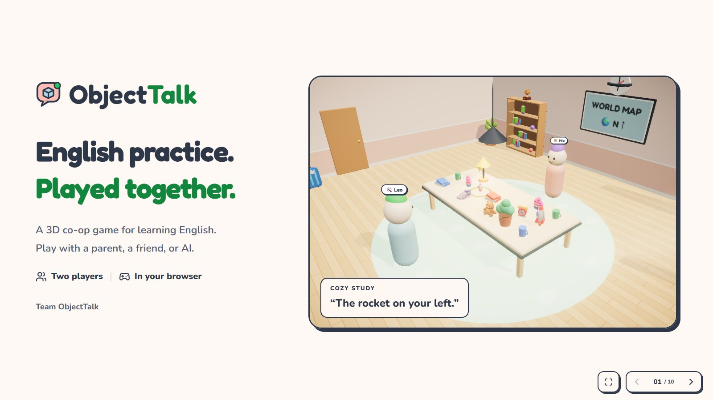

<div align="center">


# ObjectTalk

### Say it clearly. Solve it together.

A two-player 3D English game. One player sees the goal. The other makes the move.

[](https://github.com/wangzh12023/ObjectTalk/actions/workflows/ci.yml)
[](https://github.com/wangzh12023/ObjectTalk/actions/workflows/pages.yml)


[**Play in your browser**](https://objecttalk-demo.vercel.app/) · [**Watch the film**](https://objecttalk-demo.vercel.app/demo) · [**Pitch presentation**](https://objecttalk-demo.vercel.app/pitch) · [简体中文](README.zh-CN.md)


</div>

[GitHub Pages mirror](https://wangzh12023.github.io/ObjectTalk/)

## English with a reason to be clear

“Move the rocket left.” **Whose left?**

In ObjectTalk, each teammate knows something the other does not. Describe the target, ask a question, and act together. Words change where the objects go, what reaches the tray, and which street your partner takes.

Play with a friend, a parent, or an AI teammate. At the end of a round, review the conversation, replay the actions, and practise clearer expressions.

## Pick a world

| World | Work together to… | English in action |
|---|---|---|
| Cozy Study | Find and place the right objects | Position, perspective, clarification |
| Corner Café | Complete the customer's order | Quantities, sizes, polite requests |
| Toy Town | Guide a walker through the streets | Directions and landmarks |
| Messy Bedroom | Find something hidden in the room | Containers, furniture, location |
| Night Market | Visit shops, climb galleries, and finish a shopping list | Orders and multi-step directions |
| Music Room, Fruit Market, Pet Shop | Explore more everyday tasks | Objects, descriptions, and requests |


These screenshots show the running game, with the player's mission, voice controls, and 3D view.

<table>
  <tr>
    <td width="50%"><br /><b>Cozy Study</b><br />Describe an object and guide your teammate's next move.</td>
    <td width="50%"><br /><b>Corner Café</b><br />Listen to an order, choose quantities and sizes, then serve.</td>
  </tr>
  <tr>
    <td><br /><b>Toy Town</b><br />Use streets and landmarks to guide a walk through town.</td>
    <td><br /><b>Night Market</b><br />Find the shop, talk to its owner, and bring the shopping bag back.</td>
  </tr>
  <tr>
    <td><br /><b>Messy Bedroom</b><br />Ask where to look and search around furniture and containers.</td>
    <td><br /><b>Music Room</b><br />Play with instruments in a level made by the Scene Agent.</td>
  </tr>
</table>

## A complete practice loop

- **Different views, one shared task.** The acting player cannot see the answer.
- **Voice first.** Speak with your teammate; typing and optional captions are available.
- **An AI partner that acts.** Rule-based partners work without provider keys; a configured LLM can use bounded game tools.
- **Private help when you need it.** Ask for an English phrase in Chinese, then say it yourself.
- **Feedback you can inspect.** Replays, suggested expressions, vocabulary review, and an estimated speaking level.
- **Your objects, in the game.** Object Studio can identify a photo and generate a playable 3D object with Hyper3D Rodin.
- **More worlds from a scene brief.** Scene Agent plans, generates, validates, and publishes compatible levels.

## A Scene Agent that builds something you can play

Give ObjectTalk a theme such as **“music class”** or **“fruit market”**. Its Scene Agent selects a supported game format, plans distinct objects and language tasks, reviews reference images, and calls Hyper3D Rodin to make the 3D assets. It then optimizes the models and simulates missions before publishing the level.



**Try the results:** Music Room and Fruit Market are shipped Agent-generated levels, available in the room's world selector. Their published [level bundles](content/levels) include asset provenance and validation results.

ObjectTalk owns the game-specific planning and validation; [Hyper3D's official API and tools](https://hyper3d.ai/features/mcp) provide the modeling capability. The current pipeline supports **tabletop find-and-place** and **counter-order** levels, with themed objects, room colors, signs, and phrasebooks. Night Market's architecture and walkable routes are authored and checked separately. New levels must pass every sampled mission across all three difficulty settings before publication; sampled checks are recorded as evidence, not a guarantee for every possible round.

## From room to review

<table>
  <tr>
    <td width="50%"><br /><b>Choose your shared task</b><br />Pick a world, choose your seat, and invite a friend or an AI teammate.</td>
    <td width="50%"><br /><b>Bring your own objects</b><br />Object Studio connects photo identification, 3D generation, and playable objects.</td>
  </tr>
  <tr>
    <td><br /><b>Review a completed round</b><br />See the report, practise clearer expressions, and replay what happened.</td>
    <td><br /><b>Come back to your own progress</b><br />Your saved rounds, skill scores, and word book stay in this browser.</td>
  </tr>
</table>

## Your progress, without an account

Your chosen name, completed-game summaries, and word book are saved in your browser. Return to the **same site in the same browser** to continue without signing in. A new browser or private window starts with **zero games and no scores**. Clearing the site's browser data removes these local records. Shared rooms and shareable replays are managed by the game server.

<details>
  <summary>What a new player sees before their first game</summary>
  
</details>

## Watch or present

The **53-second film** introduces the product and shows the original live 3D scenes. The **ten-slide pitch** includes the finished film, scene switching, keyboard navigation, and fullscreen playback.



[Open the pitch](https://objecttalk-demo.vercel.app/pitch) · [Download the 1080p60 film](https://objecttalk-demo.vercel.app/demo/ObjectTalk-launch-film-53s-1080p60.mp4?v=49eeae0e0d69)

## Run locally

Requires **Node.js 22 or later**.

```bash
git clone https://github.com/wangzh12023/ObjectTalk.git
cd ObjectTalk
npm ci
npm run dev
```

Open **http://localhost:5173**. Create a room, choose a world, and invite a second player or choose an AI teammate.

No API key is needed for local rule-based play. To use your own AI or live 3D generation, copy `.env.example` to `.env` and configure `LLM_API_KEY`, `LLM_BASE_URL`, and/or `RODIN_API_KEY`. Keep these server-only values out of the browser and Git.

| Command | Purpose |
|---|---|
| `npm run dev` | Frontend and realtime server |
| `npm run check` | Type checking, tests, and production build |
| `npm run build && npm start` | Run the complete production application |
| `npm run build:pages` | Build the GitHub Pages frontend |
| `npm run agent -- level "music class"` | Generate and validate a new level |

## Hosting

The frontend can run on **Vercel or GitHub Pages**. Models, fonts, textures, and films are served with the frontend; realtime rooms, AI calls, generated objects, and replay persistence live on the Node server.

Set the public HTTPS backend in `deployment.config.json` or override it with `VITE_BACKEND_URL`. Provider keys belong only on the backend. The included `vercel.json` sets the SPA routes and static-asset cache headers; the Pages workflow deploys each push to `main`.

To make a standalone offline Pages build, set `VITE_BACKEND_URL` to an empty string while running `npm run build:pages`. In that mode, rule-based solo play and replays run inside the browser; cross-device rooms and online AI require the backend.

The hosted backend currently runs on the team's computer through a temporary HTTPS tunnel. It requires that computer and tunnel to remain online; a tunnel restart may require updating the public endpoint.

## Built with

React 19 · TypeScript · Three.js · React Three Fiber · Socket.IO · Express · Tailwind CSS

**131 optimized 3D models**, generated with [Hyper3D Rodin](https://hyper3d.ai), complement the project's procedural rooms, streets, furniture, and avatars. Models load by scene and are cached independently of the AI backend.

## License and credits

ObjectTalk source code is available under the **[MIT License](LICENSE)**. Generated assets and third-party material retain their own terms; see **[NOTICE.md](NOTICE.md)**. Reference artwork includes Microsoft Fluent Emoji. The finished film uses original synthesized music.

Made for **ShanghaiTech Techathon 2026**.
