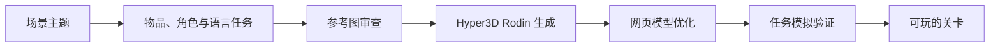

<div align="center">


# ObjectTalk

### 你说清楚，队友才能通关。

双人 3D 英语沟通游戏：一个人知道目标，另一个人负责行动。

[开始试玩](https://objecttalk-demo.vercel.app/) · [观看影片](https://objecttalk-demo.vercel.app/demo) · [路演演示](https://objecttalk-demo.vercel.app/pitch) · [English](README.md)


</div>

[GitHub Pages 备用入口](https://wangzh12023.github.io/ObjectTalk/)

“把火箭移到左边。”——**谁的左边？**

两名玩家看到的信息不同，必须靠描述、追问和行动完成同一个任务。可以与朋友、家长或 AI 搭档；赛后查看行动回放、表达建议与单词记录，再练一次更清楚的说法。

## 每个场景，都有一件事要一起办成

| 场景 | 合作任务 | 练习内容 |
|---|---|---|
| 书房 | 寻找、摆放物品 | 方位与视角 |
| 咖啡馆 | 完成顾客订单 | 数量、大小与礼貌表达 |
| 小镇 | 带队友走到目的地 | 问路、转向与地标 |
| 卧室 | 找到藏起来的东西 | 家具、容器与位置 |
| 夜市 | 上楼逛店，完成购物清单 | 点单与多步沟通 |
| 音乐室、水果市场、宠物店 | 更多生活任务 | 描述、识别与请求 |


下面均为实际运行界面，保留任务卡、语音工具和玩家看到的 3D 视角。

<table>
  <tr>
    <td width="50%"><br /><b>书房</b><br />描述物品与位置，让队友找到并摆放正确的东西。</td>
    <td width="50%"><br /><b>咖啡馆</b><br />听懂订单中的数量和大小，配好餐后交给顾客。</td>
  </tr>
  <tr>
    <td><br /><b>小镇</b><br />结合街道与地标，带队友走到目的地。</td>
    <td><br /><b>夜市</b><br />找到商铺，与店主交流，再把购物袋带回入口。</td>
  </tr>
  <tr>
    <td><br /><b>卧室</b><br />追问藏在哪里，在家具周围与容器里寻找物品。</td>
    <td><br /><b>音乐室</b><br />体验 Scene Agent 生成的关卡，用英语描述和识别乐器。</td>
  </tr>
</table>

## 从开口到复盘

- 信息差协作：行动者收不到隐藏答案。
- 语音优先，也支持打字与可选字幕。
- AI 搭档可以使用游戏工具执行行动；无密钥时保留规则搭档。
- 卡住时私下获得英文表达，自己再向队友说出来。
- 保存行动与对话回放，查看表达建议、词汇记录和口语水平估计。
- Object Studio 可通过照片识别与 Rodin 生成，把自己的物品加入游戏。
- Scene Agent 可从场景主题生成并验证兼容的新关卡。

## Scene Agent：把一句主题变成能玩的关卡

输入 **“音乐课堂”** 或 **“水果市场”**，Scene Agent 会选择支持的玩法，规划物品、角色与语言任务，审查参考图，再调用 Hyper3D Rodin 生成 3D 模型。模型经过网页加载优化和任务模拟验证后，才会发布为可选关卡。



**直接体验成果：** 房间场景选择器中的 Music Room 和 Fruit Market 均由这套流水线生成；[关卡数据](content/levels) 包含模型来源与验证记录。

ObjectTalk 负责游戏专用的规划和验证，[Hyper3D 官方 API 与工具](https://hyper3d.ai/features/mcp) 提供建模能力。当前流水线支持**桌面寻找与摆放**、**柜台点单**两类关卡，包括主题物品、房间配色、招牌与表达手册；夜市建筑和通行路网另行设计与检查。新关卡发布前，三个难度下的所有抽样任务都须通过，记录的是实际抽样结果，不代表穷尽所有可能的对局。

## 从创建房间到赛后复盘

<table>
  <tr>
    <td width="50%"><br /><b>选择共同任务</b><br />挑选场景和角色，邀请朋友或选择 AI 搭档。</td>
    <td width="50%"><br /><b>把自己的物品带进来</b><br />通过照片识别、3D 生成和物品库，把熟悉的东西变成游戏内容。</td>
  </tr>
  <tr>
    <td><br /><b>完成后再复盘</b><br />查看报告、练习更清楚的说法，并回看这一局发生了什么。</td>
    <td><br /><b>下次回来继续</b><br />已完成的回合、技能表现和单词本保存在当前浏览器中。</td>
  </tr>
</table>

## 不用账号，也能保留自己的进度

玩家姓名、已完成游戏的进度摘要与单词本保存在浏览器本地。下次使用**同一浏览器访问同一网址**，不登录也能继续查看。新浏览器和无痕窗口从 **0 场游戏、暂无评分**开始；清除网站的浏览器数据会删除这些本地记录。联机房间和可分享的回放由游戏服务器管理。

<details>
  <summary>第一次访问、尚未完成游戏时的真实界面</summary>
  
</details>

## 比赛演示

完整保留 **53 秒 1080p60 产品影片**和**十页英文路演页面**。演示可切换真实 3D 场景，支持方向键翻页、全屏播放与影片结束后自动进入下一页。

[打开路演](https://objecttalk-demo.vercel.app/pitch) · [下载影片](https://objecttalk-demo.vercel.app/demo/ObjectTalk-launch-film-53s-1080p60.mp4?v=49eeae0e0d69)

## 本地运行

需要 Node.js 22 或更新版本。

```bash
git clone https://github.com/wangzh12023/ObjectTalk.git
cd ObjectTalk
npm ci
npm run dev
```

打开 http://localhost:5173，创建房间，选择场景，与另一名玩家或 AI 搭档开始游戏。

无密钥时可使用规则搭档。需要自己的 AI 或实时 3D 生成时，复制 `.env.example` 为 `.env`，配置后端的 `LLM_API_KEY`、`LLM_BASE_URL` 和 `RODIN_API_KEY`。密钥不要提交到 Git，也不要放入前端变量。

## 部署与验证

`npm run check` 执行类型检查、测试与生产构建。`npm run build && npm start` 启动完整服务；`npm run build:pages` 构建 Pages 前端。

前端支持 Vercel 和 GitHub Pages，3D 模型、字体与视频随前端发布。通过 `deployment.config.json` 或 `VITE_BACKEND_URL` 指向 HTTPS 后端，AI 调用、实时房间及生成物品由 Node 服务处理。当前托管后端运行在团队电脑上，使用临时 HTTPS 隧道，需要电脑与隧道保持在线；隧道重启后可能需要更新地址。

将 `VITE_BACKEND_URL` 设为空字符串再构建 Pages，可生成独立的离线版；规则单人游戏和回放在浏览器内运行，双设备协作和在线 AI 需要后端。

## 开源与致谢

项目源码采用 [MIT License](LICENSE)。131 个优化后的 3D 模型由 [Hyper3D Rodin](https://hyper3d.ai) 生成；第三方资源与生成资产保留各自条款，详见 [NOTICE.md](NOTICE.md)。参考图包含 Microsoft Fluent Emoji，影片使用原创合成配乐。

为上海科技大学 Techathon 2026 制作。
